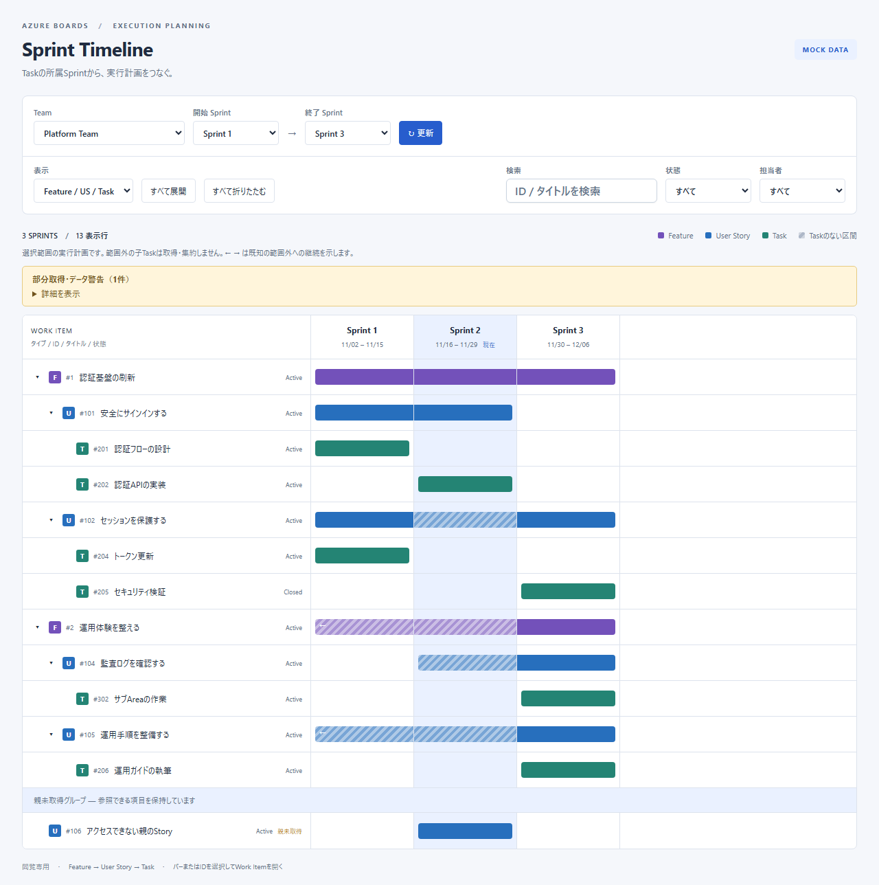
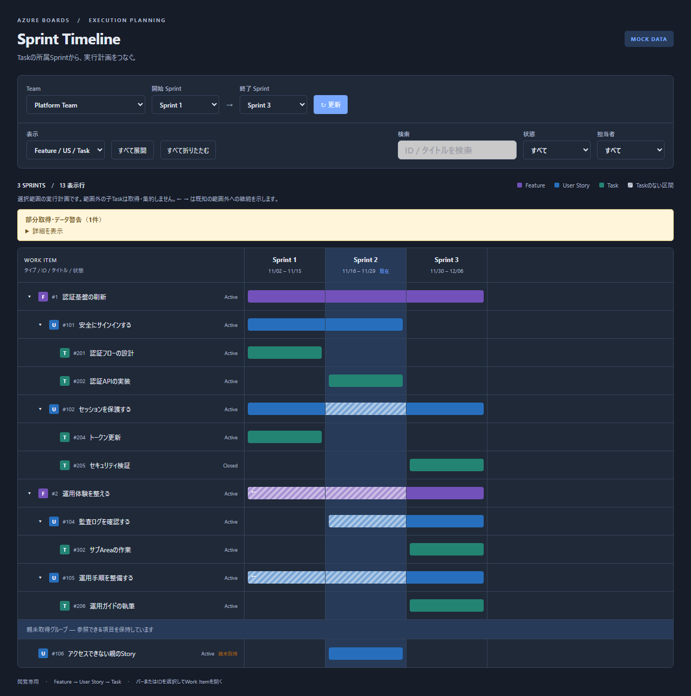

# Sprint Timeline

See your Azure Boards execution plan in Sprint-sized columns. Follow Features, User Stories, and Tasks across Sprints, with Story periods aggregated from their child Tasks—even when a Story's own Iteration Path is unplanned or assigned to another Sprint. The extension is read-only.

_Synthetic demo data. Each Sprint occupies one column, regardless of its duration._

## Explore an execution plan

### Follow the work across Sprints

Select a team and a start/end Sprint. Expand a Feature to see its Stories, then expand a Story to see its Tasks. Use **Task非表示** to hide Task rows or **USのみ** to focus on Stories.

A Task occupies its assigned Sprint. A Story spans the earliest through latest Sprint represented by its fetched Tasks and its own valid Sprint assignment. A Feature inherits the periods of its Stories; its own Iteration Path does not determine the bar.

When Tasks exist in Sprint 1 and Sprint 3, the Story spans all three columns and marks Sprint 2 with hatching. Arrows indicate known continuation beyond the selected range. Dates appear only as supplementary column labels; the axis has no daily, weekly, or monthly scale.

### Find the items you need

Search by ID or title, or filter by state and assignee. Matching items keep their ancestors, and hidden children continue to contribute to the aggregated period. Collapsing rows and changing display modes also preserve the period.

Select a bar or item ID to open the Work Item form in Azure DevOps. The interface supports keyboard navigation and follows the host's light/dark theme.

## Install and open

This extension is being prepared for its first release and is not yet published. Its extension ID is `azdo-sprint-timeline`; its display name is **Sprint Timeline**.

After the public Marketplace listing is available, search for **Sprint Timeline** under Azure DevOps extensions and have an authorized organization administrator install it. Open an Agile project and choose **Boards → Sprint Timeline**. See [Publishing](PUBLISHING.md) for release preparation and the remaining verification steps.

## What to expect

The initial scope is Azure DevOps Services, one project, one selected team, and Agile's standard Feature → User Story → Task hierarchy. The UI currently uses Japanese labels. Scrum Product Backlog Items, Basic/custom work item types, Epics, and combined multi-team plans are outside this release's scope.

Only Stories and Tasks assigned to the selected Sprints and team Areas start the selection. Their required ancestors are retained, including unplanned Stories and Features. Unplanned siblings are excluded. Closed items are included by default.

The timeline represents the selected-range execution plan. Tasks outside that range are not fetched or aggregated. A known out-of-range Sprint assigned to an ancestor Story can still extend its period, so the bar should not be read as the complete lifetime of all its work.

Unavailable parents, unexpected hierarchies, API limits, and partial retrievals produce warnings. Permissions and network errors have separate retryable states. Real-organization SDK startup, theme changes, and form navigation remain unverified; see [Testing](TESTING.md).

## Data and permissions

The extension uses Azure DevOps SDK authentication and read-only work/project permissions. It does not update Work Items, store a PAT, send data to an external backend, or collect telemetry. Work Item data and tokens are not persisted by the extension.

## Support and development

See [Support](SUPPORT.md) for what to include in a bug report. For mock startup, tests, builds, and repository structure, see [Development](docs/development.md). Release changes are listed in the [Changelog](CHANGELOG.md).

This is an independent project and is not affiliated with or endorsed by Microsoft. Licensed under the [MIT License](LICENSE). See [third-party notices](THIRD_PARTY_NOTICES.txt) for bundled dependencies.
